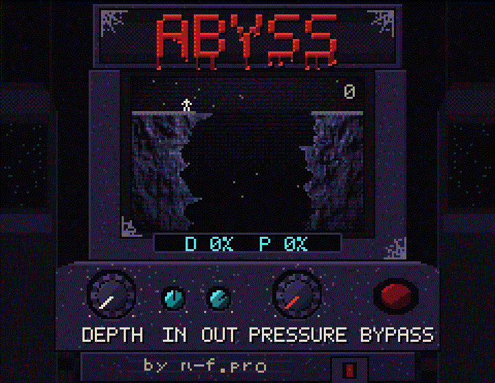
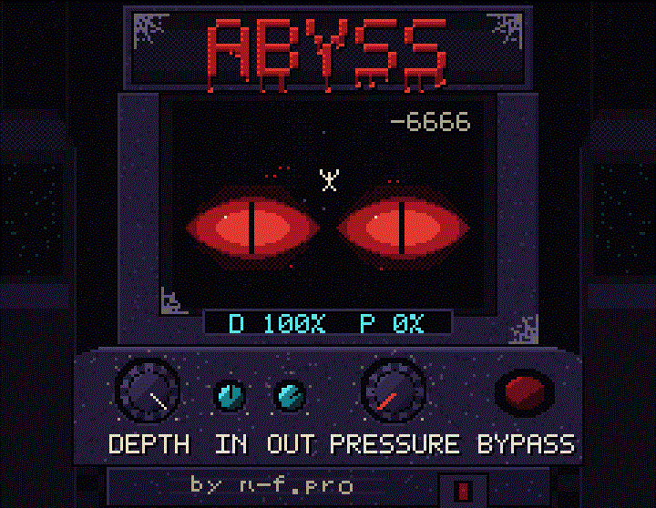

# Abyss

Abyss is a Windows VST3 that makes a sound lower and darker. **DEPTH** puts a sub-octave under the signal, and past halfway a second octave as well, while the top end closes in. **PRESSURE** adds saturation and a linked compressor. The faceplate is a pixel-art arcade cabinet.

Made by [n-f.pro](https://n-f.pro).



Turn DEPTH up and the figure drops down the shaft. The counter runs toward the bottom, and from the middle of the range the red eyes come forward.



PRESSURE stains the screen red and, at the top of the range, pulls the picture apart.

## Install

Download `Abyss-1.0.0-Windows.zip` from the [releases](https://github.com/niobiumface/abyss-vst/releases) page and run `AbyssSetup.exe`.

The installer lists the usual VST3 folders and lets you tick more than one. **Add folder…** appends any other directory. Install copies `Abyss.vst3` into every folder you leave checked. Restart the DAW and rescan plugins. Abyss shows up as **Abyss** by **n-f.pro**.

Windows asks for administrator rights once, so the system VST3 folder can be written.

## Controls

| Control | What it does |
|---|---|
| DEPTH | Sub level, a second sub from halfway, and a lowpass that follows the playing level |
| PRESSURE | Drive plus compression |
| IN / OUT | Input and output gain |
| BYPASS | Equal-gain crossfade. The screen shows INSERT COIN |
| Click ABYSS | Factory presets, save, load, A/B |

Oversampling (Off / 2x / 4x), clean or grit sub, the second sub, ceiling, mix, and auto-gain are in the context menu.

## Build

Visual Studio 2022 and CMake 3.22 or newer.

```powershell
cmake -S . -B build -G "Visual Studio 17 2022" -A x64 -DABYSS_STANDALONE=ON
cmake --build build --config Release --parallel
ctest --test-dir build -C Release
```

The plugin bundle is `build\Abyss_artefacts\Release\VST3\Abyss.vst3`. JUCE 8.0.15 is fetched at configure time.
